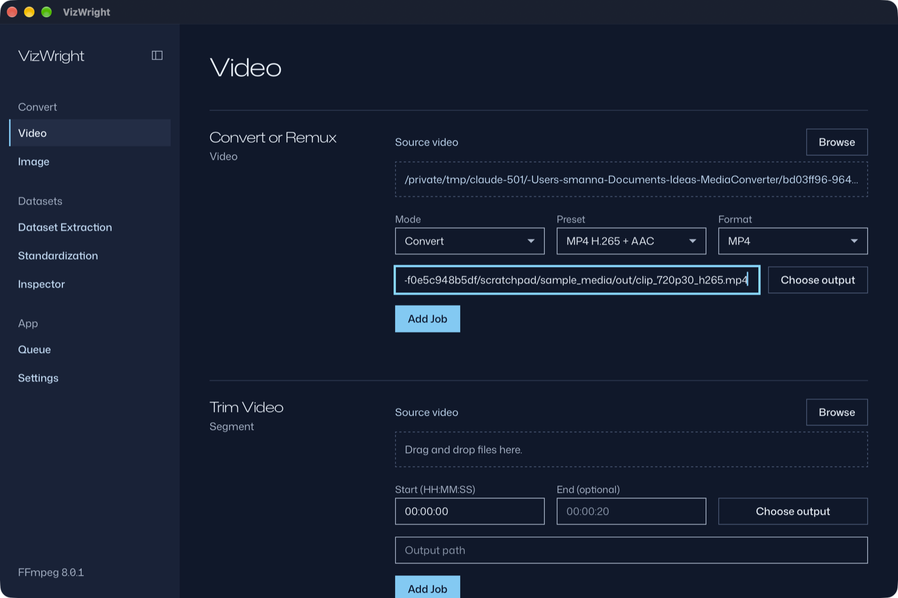
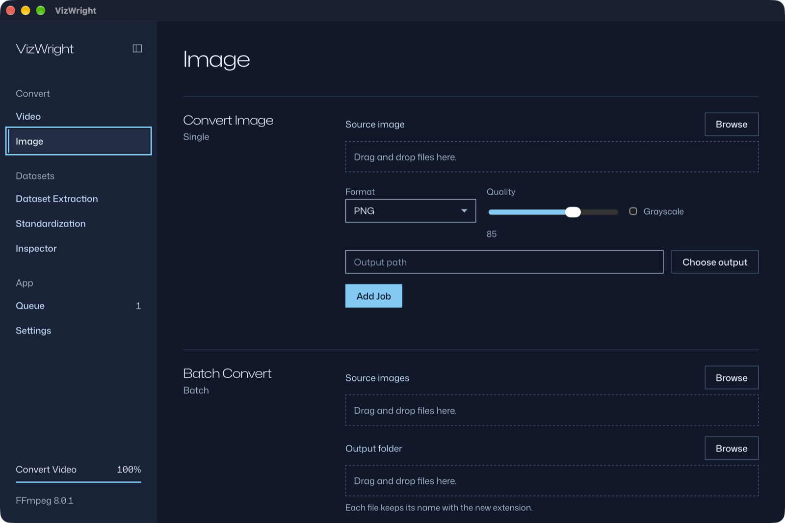
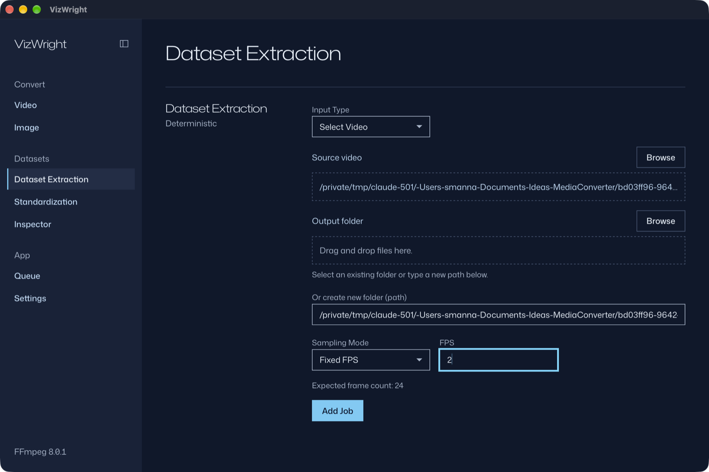
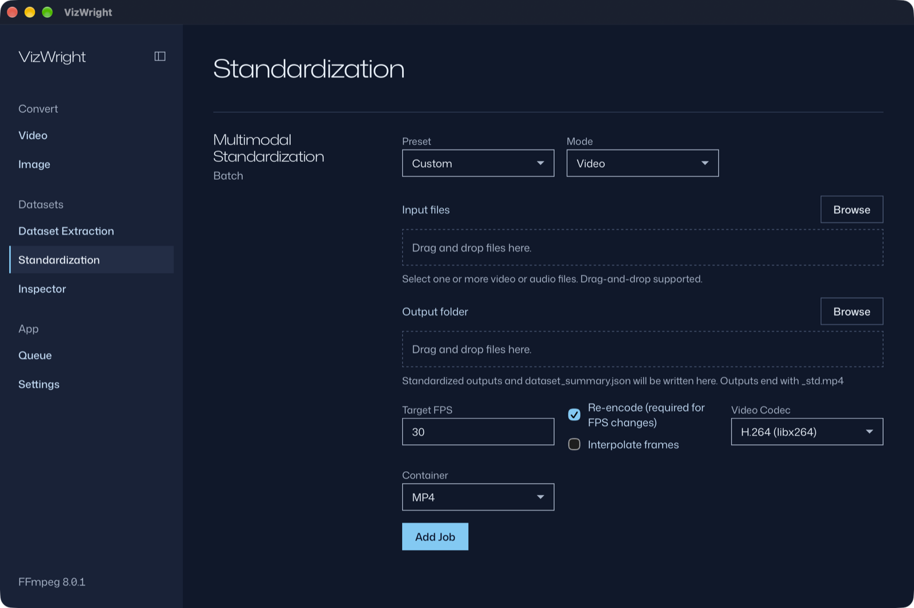
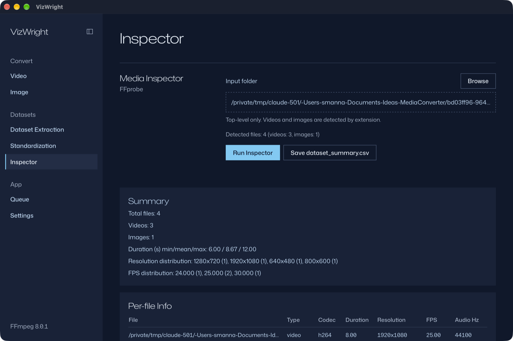
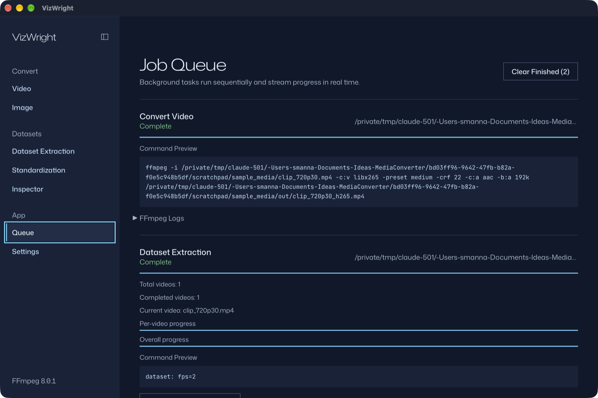
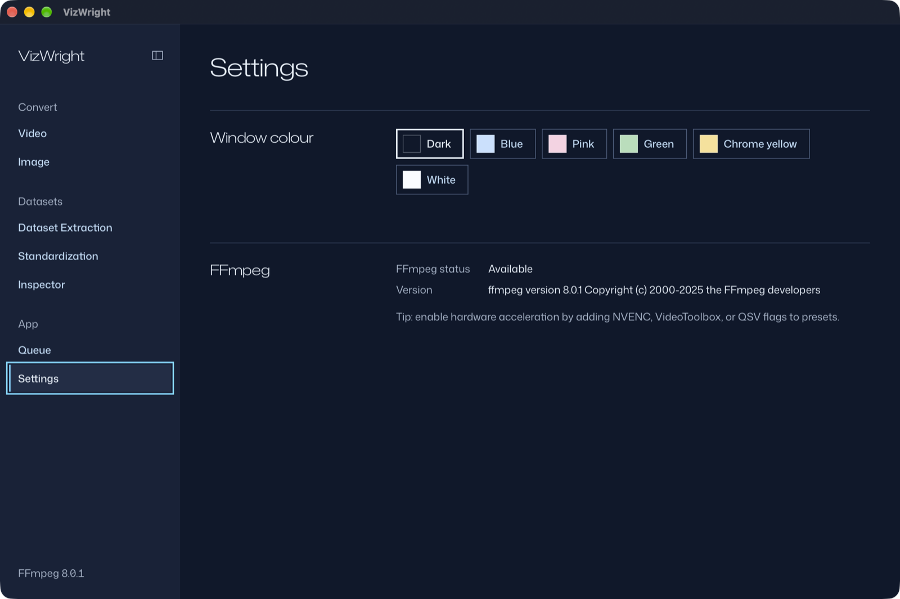
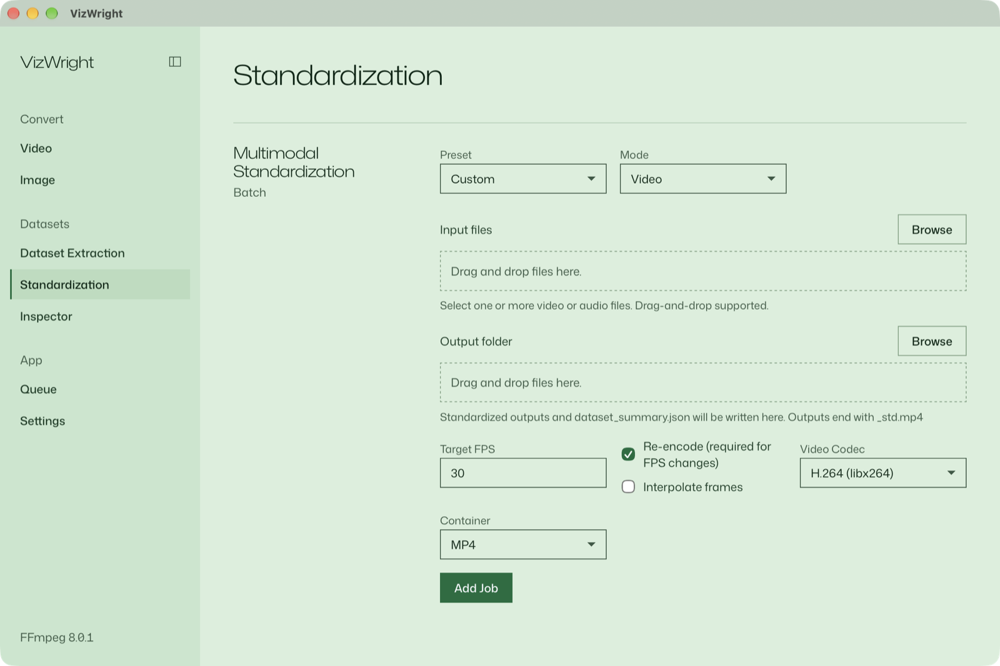

# VizWright: A Desktop GUI for FFmpeg, Built with Tauri, Rust and React

*How it works, how to use each tool, and which FFmpeg commands run behind every button.*



FFmpeg can do almost anything with audio, video and images. The hard part is remembering the flags. Was it `-ss` before or after `-i`? Which `-crf` is "good enough" for x265? How do you turn a folder of PNGs into a video without the frames coming out in the wrong order?

I built **VizWright** to stop looking these up. It's an open-source desktop app for macOS, Windows and Linux. It wraps FFmpeg and ffprobe in a clean interface with a job queue, live progress and logs. It also handles a use case most FFmpeg GUIs skip: **preparing media datasets for machine learning**. That means deterministic frame extraction with manifests, batch normalisation of FPS or sample rate, and dataset-level statistics.

This article covers:

1. The architecture: how a click in a React UI becomes an FFmpeg process run from Rust
2. How to install and run it
3. A walkthrough of each tool, with the exact FFmpeg/ffprobe commands and backend code behind it

Source code: [github.com/sadimanna/mediaconverter](https://github.com/sadimanna/mediaconverter)

---

## 1. The architecture in one picture

VizWright is a **Tauri v2** application. Tauri renders the UI in the operating system's own webview (WebKit on macOS and Linux, WebView2 on Windows). The UI talks to a small native **Rust** backend. Electron ships a whole Chromium; Tauri doesn't, so the installers stay small and the app starts fast.

```
┌──────────────────────────────┐        invoke("run_ffmpeg_with_progress", { args })
│  React 18 + TypeScript UI    │ ───────────────────────────────────────────────┐
│  (Vite, Tailwind CSS)        │                                                ▼
│                              │                                  ┌───────────────────────────┐
│  Video · Image · Dataset     │                                  │  Rust backend (Tauri)     │
│  Standardize · Inspector     │                                  │  src-tauri/src/ffmpeg.rs  │
│  Queue · Settings            │                                  │                           │
│                              │   events: ffmpeg-progress        │  std::process::Command    │
│  listens with @tauri-apps/api│ ◀──────── ffmpeg-log ─────────── │   ├─ ffmpeg  (spawned)    │
│                              │           ffmpeg-exit            │   └─ ffprobe (probing)    │
└──────────────────────────────┘           dataset-progress …     └───────────────────────────┘
```

Three design choices shape the rest of the app:

**1. The frontend builds the command; the backend runs it.** Each tool in React assembles an argument array, such as `["-i", input, "-c:v", "libx265", …, output]`, and sends it to a Rust command through Tauri's `invoke`. Rust passes the array straight to `std::process::Command`. **No shell is involved**, so a filename with spaces, quotes or `;` is just a filename. There's nothing to escape and no shell injection.

**2. Progress comes from FFmpeg itself.** Before spawning FFmpeg, the backend appends `-progress pipe:1 -nostats` (and prepends `-hide_banner`). FFmpeg then writes machine-readable `key=value` lines to stdout:

```
out_time_ms=4520000
fps=212.4
speed=7.08x
progress=continue
```

A small parser in `progress.rs` collects these keys. On every `progress=` line it emits a snapshot. The backend first asks ffprobe for the input's duration:

```
ffprobe -v error -show_entries format=duration -of default=noprint_wrappers=1:nokey=1 input.mp4
```

so it can turn `out_time_ms` into a percentage. Each FFmpeg process gets **three background threads**: one reads stdout for progress, one reads stderr for logs, and one waits for the exit code. They push `ffmpeg-progress`, `ffmpeg-log` and `ffmpeg-exit` events to the UI.

**3. Jobs can be cancelled.** Each spawned process goes into a `JobRegistry`, a `HashMap<job_id, Arc<Mutex<Child>>>` held as Tauri managed state. The job id is a UUID v4. Cancelling a job looks up the child process and calls `kill()`.

### The Rust crates used

| Crate | Used for |
| --- | --- |
| `tauri` 2.x + `tauri-plugin-dialog` | Window, IPC (`invoke`/events) and native open/save dialogs. The window's capability file grants only `core:default` plus dialog open and save. |
| `serde`, `serde_json` | Request/response types, and parsing ffprobe's `-of json` output |
| `uuid` (v4) | Job ids and temp file names |
| `rand` (`StdRng`) | Seeded, reproducible random frame sampling |
| `sha2` + `hex` | SHA-256 checksums of standardised outputs |
| `csv` | `manifest.csv` / `global_manifest.csv` writers |

### Finding FFmpeg

The app doesn't bundle FFmpeg; you install it once yourself. A GUI app launched from the macOS Dock gets a minimal `PATH` that doesn't include Homebrew's folders. To handle that, `resolve_binary()` checks `PATH` first, then `/opt/homebrew/bin`, `/usr/local/bin`, `/opt/local/bin`, `/usr/bin`, `/snap/bin` and the Linuxbrew prefix. The result is cached in a `OnceLock`. At startup the backend runs `ffmpeg -version` and emits an `ffmpeg-check` event, and the sidebar footer shows the version it found (here, *FFmpeg 8.0.1*).

---

## 2. Installing and running

**Step 1: Install FFmpeg** (it must provide both `ffmpeg` and `ffprobe`):

```bash
brew install ffmpeg              # macOS
sudo apt-get install -y ffmpeg   # Debian / Ubuntu
winget install Gyan.FFmpeg       # Windows
```

**Step 2: Get the app.** Download an installer for your OS from the [GitHub Releases page](https://github.com/sadimanna/mediaconverter/releases/latest). GitHub Actions builds them from each tagged commit. The installers aren't code-signed, so macOS and Windows may warn you the first time you open the app.

**Step 3 (optional): Build from source.** You need Node 20+ and a current stable Rust from `rustup`. On Linux you also need WebKitGTK 4.1 (`libwebkit2gtk-4.1-dev`).

```bash
git clone https://github.com/sadimanna/mediaconverter.git
cd mediaconverter
npm ci
npx tauri dev      # run with live reload
npx tauri build    # produce native installers
```

**Step 4: Learn the layout.** The left rail groups the tools into **Convert** (Video, Image), **Datasets** (Dataset Extraction, Standardization, Inspector) and **App** (Queue, Settings). Every tool follows the same pattern:

> **Pick input → choose options → pick an output → *Add Job* → watch it in the Queue.**

You can pick inputs with **Browse** (a native file dialog) or by dragging files onto the dashed drop zone.

---

## 3. The tools, one by one

### 3.1 Video


The Video tab has six panels. Each one builds an argument array and sends it to the `run_ffmpeg_with_progress` Rust command. The last panel is the exception and uses its own command.

**Convert or Remux**

1. Drop or browse to a source video.
2. Choose **Mode**: *Convert* (re-encode) or *Remux* (copy streams into a new container).
3. Pick the output **Format** (MP4, MKV, WebM, AVI, MOV) and a **Preset**. The preset list only shows presets that are valid for the chosen format.
4. Pick an output path, then click **Add Job**.

Presets live in `presets.json`, which holds 27 video presets: H.264, H.265, AV1 (SVT-AV1), VP8/VP9, MPEG-2/4, ProRes, DNxHD and MJPEG, each paired with a matching audio codec. Each preset is just a list of FFmpeg arguments, so adding your own (NVENC or VideoToolbox, say) means editing JSON. Here's the exact command the app ran for the screenshot above:

```bash
ffmpeg -i clip_720p30.mp4 -c:v libx265 -preset medium -crf 22 -c:a aac -b:a 192k clip_720p30_h265.mp4
# Remux mode instead:
ffmpeg -i input.mkv -c copy output.mp4
```

**Trim Video.** Enter a start time and an optional end time in `HH:MM:SS`. The app uses input seeking with stream copy, so trimming is close to instant and doesn't re-encode. Because no frames are re-encoded, cuts land on the nearest keyframes.

```bash
ffmpeg -ss 00:00:05 -to 00:00:20 -i input.mp4 -c copy trimmed.mp4
```

**Extract Audio.** Choose MP3, WAV, AAC or FLAC; these are the `audio_extract` presets. Each preset drops the video stream and encodes the audio, for example:

```bash
ffmpeg -i input.mp4 -vn -c:a libmp3lame -q:a 2 audio.mp3
```

**Merge Audio + Video.** Pick a video file and a separate audio file. The video stream is copied untouched, the audio is encoded to AAC, and `-shortest` cuts the output at whichever input ends first.

```bash
ffmpeg -i input.mp4 -i voiceover.wav -c:v copy -c:a aac -b:a 192k -shortest merged.mp4
```

**GIF to Video.** This uses the same preset system as Convert, filtered by output format:

```bash
ffmpeg -i animation.gif -c:v libx264 -preset ultrafast -crf 28 -c:a aac -b:a 128k animation.mp4
```

**Images to Video.** Select many images, set a frame rate, and optionally tick *Sort by filename* so the frames go in the right order. This panel calls its own Rust command, **`run_ffmpeg_image_sequence`**. It writes the image list to a temporary FFmpeg *concat* file (`ffmpeg_concat_<uuid>.txt` in the OS temp folder), escaping quotes and backslashes, and runs:

```bash
ffmpeg -f concat -safe 0 -i /tmp/ffmpeg_concat_<uuid>.txt -r 30 <preset args> sequence.mp4
```

An image list has no duration for ffprobe to read, so the backend works one out as *number of images ÷ frame rate* and uses that for the progress bar.

---

### 3.2 Image



The Image tab uses FFmpeg's image encoders and filters. It has three panels:

1. **Convert Image**: one file to PNG, JPEG or WebP, with a **Quality** slider and a **Grayscale** toggle.
2. **Batch Convert**: many files into an output folder. Each file keeps its name and gets the new extension.
3. **Resize**: set a width, a height, or both. The aspect ratio is always preserved.

The quality slider (0–100) maps onto each encoder's own scale:

| Output | Arguments added |
| --- | --- |
| JPEG | `-q:v N`, where `N = max(2, round((100 − quality) / 2))`, because lower `q:v` means higher quality in the MJPEG encoder |
| WebP | `-quality <quality>` |
| PNG | nothing (PNG is lossless) |

The filters are built as a single `-vf` chain:

```bash
# Resize to fit inside 1280x720, keeping aspect ratio, and convert to grayscale
ffmpeg -i photo.jpg -vf "scale=1280:720:force_original_aspect_ratio=decrease,format=gray" -q:v 8 photo_small.jpg
# Only a width given → height follows the aspect ratio
ffmpeg -i photo.png -vf "scale=800:-1" photo_800.png
```

Batch Convert doesn't run a single long command. It adds **one queue job per image**, so each file gets its own progress, log and success or failure status.

---

### 3.3 Dataset Extraction: video → frames, reproducibly



This is the main reason the app exists. To train a vision model on video, you need frames, and you need to be able to say exactly which frames came from where.

**Steps**

1. Choose **Input Type**: a single video, or a folder. For a folder, only its top level is scanned for `.mp4`, `.mkv`, `.mov`, `.avi` and `.webm` files.
2. Choose an existing **Output folder**, or type a path for a new one.
3. Choose a **Sampling Mode**:
   - **Fixed FPS**: N frames per second
   - **Every Nth Frame**
   - **Uniform Random K**: K frames chosen at random, with a **seed**
4. Check the **Expected frame count**. When you pick a video, the UI calls the `probe_video` command, which runs ffprobe for width, height, average frame rate, frame count and duration, and computes the estimate. In the screenshot, a 12-second clip at 2 fps gives **24**.
5. Click **Add Job**.

**What the backend does** (`run_dataset_extraction`, on its own thread):

Each sampling mode becomes a filter expression, with `showinfo` appended:

```bash
# Fixed FPS
ffmpeg -i clip.mp4 -vf "fps=2,showinfo" -vsync 0 -c:v png out/clip/clip_%06d.png
# Every 10th frame
-vf "select='not(mod(n\,10))',showinfo"
# Uniform random K=4, seed=42 → e.g.
-vf "select='eq(n\,37)+eq(n\,112)+eq(n\,205)+eq(n\,301)',showinfo"
```

For **random** mode, the backend first needs the total frame count. It tries three sources in order: the stream's `nb_frames`, then `duration × avg_frame_rate`, and if both fail it counts frames with `ffprobe -count_frames`. It then shuffles the frame indices with a seeded `rand::rngs::StdRng`, takes the first K and sorts them. **The same seed always selects the same frames**, so a dataset can be rebuilt exactly.

The `showinfo` filter prints a line to stderr for each frame it outputs. The log thread parses `n:`, `pts_time:` and `s:` (resolution) from those lines, so each saved PNG can be matched to its **timestamp in the source video**. The backend writes all of this out as CSV:

```
frames/
├─ global_manifest.csv
└─ clip_720p30/
   ├─ manifest.csv
   ├─ clip_720p30_000001.png
   ├─ clip_720p30_000002.png
   └─ …
```

These are the first rows from the run in the screenshot (source path shortened):

```csv
source_video,video_id,frame_index,timestamp,relative_output_path
…/clip_720p30.mp4,clip_720p30,1,0.0,clip_720p30/clip_720p30_000001.png
…/clip_720p30.mp4,clip_720p30,2,0.5,clip_720p30/clip_720p30_000002.png
…/clip_720p30.mp4,clip_720p30,3,1.0,clip_720p30/clip_720p30_000003.png
```

Other details:

- **Video ids** come from the file name, with every non-alphanumeric character replaced by `_`, so folder names are always safe.
- **Failures don't stop the batch.** Errors are appended to `errors.log` in the output folder, and the job moves on to the next video. The final status reports how many videos failed.
- **Two-level progress.** A `dataset-progress` event carries both per-video progress and overall progress, which is `(completed + current fraction) / total`.

---

### 3.4 Multimodal Standardization



Mixed datasets often contain videos at 24, 25, 29.97 and 60 fps, and audio at 44.1 kHz stereo next to 48 kHz mono. Standardization normalises a whole batch to one target.

**Steps**

1. Pick a **Preset**: *Speech ML (16 kHz mono)*, *Video ML (30 fps H.264)* or *Custom*.
2. Pick a **Mode**: *Video* or *Audio*.
3. Add input files and choose an output folder.
4. Set the options:
   - Video: target FPS, codec (H.264, H.265, SVT-AV1, MPEG-4), container, and optional **frame interpolation**
   - Audio: sample rate, channels (1 or 2), WAV or FLAC
5. Click **Add Job**. Outputs are named `<name>_std.<ext>`.

**Backend** (`run_standardization_batch`):

Before running anything, `validate_video_target()` checks the codec and container against a compatibility table. For example, WebM only accepts SVT-AV1 here, and AVI rejects AV1. Invalid combinations fail with a clear message instead of an obscure FFmpeg error. The commands are:

```bash
# Video mode
ffmpeg -y -i input.mov -r 30 -c:v libx264 -pix_fmt yuv420p -c:a copy input_std.mp4
# … with "Interpolate frames" ticked, motion-interpolated instead of duplicated/dropped:
ffmpeg -y -i input.mov -r 30 -c:v libx264 -pix_fmt yuv420p -c:a copy -vf minterpolate=fps=30 input_std.mp4

# Audio mode (Speech ML preset)
ffmpeg -y -i input.mp4 -vn -ar 16000 -ac 1 -c:a pcm_s16le input_std.wav
```

After each file, the backend probes the output again (resolution, duration) and computes its **SHA-256** with the `sha2` crate. When the batch finishes it writes a `dataset_summary.json` that records, for every file, the source path, output path, the settings used, the measured resolution and duration, and the checksum. You can check later that a file is the one that was produced, and you can see the settings that produced it. The Queue has a button to save a copy of this summary anywhere you like.

---

### 3.5 Media Inspector



Before cleaning a dataset, you need to know what's in it. The Inspector scans one folder and answers "what have I actually got?"

**Steps**

1. **Browse** to a folder. The *Detected files* count updates right away, using a `scan_media_folder` call that classifies files by extension.
2. Click **Run Inspector**.
3. Read the **Summary** and the **Per-file Info** table. Click **Save dataset_summary.csv** to export them.

**Backend** (`inspect_media`): for each file it runs a single ffprobe call with JSON output:

```bash
ffprobe -v error \
  -show_entries stream=codec_name,codec_type,width,height,avg_frame_rate,sample_rate \
  -show_entries format=duration -of json file.mp4
```

From the result it takes the first video stream (codec, resolution, frame rate) and the first audio stream (sample rate). Frame rates like `30000/1001` arrive as fractions and are parsed into decimal numbers. `build_inspector_stats()` then aggregates the entries:

- total, video and image counts
- min / mean / max duration
- resolution distribution and FPS distribution, rounded to 3 decimals

The screenshot is a real run on four test files: three clips (720p30, 1080p25, 480p24) and one PNG. One quirk is visible: ffprobe reports a still image's `avg_frame_rate` as 25, so the PNG adds to the *25.000* count. The CSV export is written by a small `write_text_file` command.

---

### 3.6 The Job Queue



Every *Add Job* click lands here. The queue:

- runs jobs **one at a time**. A React effect starts the next `queued` job once nothing is `running`, so several heavy encodes never compete for the CPU.
- shows each job's **Command Preview**, the exact `ffmpeg …` line it will run. This is a good way to learn FFmpeg flags.
- shows **live progress**. For dataset jobs it shows per-video and overall progress separately.
- has a collapsible **FFmpeg Logs** pane fed by the stderr thread, so you can see FFmpeg's own error message when a job fails.
- lets you **cancel** a running job (the registry calls `Child::kill()`) or remove a queued one.
- offers **Save manifest** and **Save summary** buttons for dataset and standardization jobs. These copy the generated file to a location you choose, using the `copy_file` command.

The running job also appears in a compact progress widget in the sidebar, so you can keep working in other tabs.

---

### 3.7 Settings and themes



Settings shows the FFmpeg status and the full version string from `ffmpeg -version`. It also has a **window colour** picker with six themes: Dark (the default, used in the screenshots above), Blue, Pink, Green, Chrome yellow and White. The choice is saved locally and applied as CSS design tokens, so the whole UI changes at once:



---

## 4. Summary: which backend does what

| Feature | Rust command | FFmpeg / ffprobe core |
| --- | --- | --- |
| Convert / Remux | `run_ffmpeg_with_progress` | preset args from `presets.json` / `-c copy` |
| Trim | `run_ffmpeg_with_progress` | `-ss … -to … -c copy` |
| Extract audio | `run_ffmpeg_with_progress` | `-vn` + MP3 / WAV / AAC / FLAC encoder |
| Merge audio + video | `run_ffmpeg_with_progress` | `-c:v copy -c:a aac -shortest` |
| GIF → video | `run_ffmpeg_with_progress` | preset args |
| Images → video | `run_ffmpeg_image_sequence` | concat demuxer `-f concat -safe 0` + `-r` |
| Image convert / batch / resize | `run_ffmpeg_with_progress` | `-q:v` / `-quality`, `scale=…:force_original_aspect_ratio=decrease`, `format=gray` |
| Expected frame count | `probe_video` | ffprobe JSON (`width,height,avg_frame_rate,nb_frames,duration`) |
| Dataset extraction | `run_dataset_extraction` | `fps=` / `select=` + `showinfo`, `-vsync 0 -c:v png`; seeded `StdRng`; `csv` |
| Standardization | `run_standardization_batch` | `-r`, `-pix_fmt yuv420p`, `minterpolate`, `-ar -ac`, `pcm_s16le`/`flac`; `sha2` |
| Inspector | `scan_media_folder`, `inspect_media`, `write_text_file` | ffprobe JSON streams + format |
| Cancel | `cancel_job` | `Child::kill()` via `JobRegistry` |
| FFmpeg detection | `check_ffmpeg` (+ startup event) | `ffmpeg -version` |

---

## 5. What's next

The codebase is set up to grow:

- **Hardware encoding**: add `h264_nvenc`, `hevc_videotoolbox` or `*_qsv` presets to `presets.json`. No code changes needed.
- **New sampling strategies**: scene-change sampling (`select='gt(scene,0.4)'`) would be one more branch in `build_dataset_filter()`.
- **More inspector fields**: bit depth, pixel format and channel layout are one extra `-show_entries` away.

If you deal with video datasets, or you're tired of looking up FFmpeg flags, try it out. Issues and PRs are welcome:
👉 **[github.com/sadimanna/mediaconverter](https://github.com/sadimanna/mediaconverter)**

*VizWright is an independent open-source project and is not affiliated with the FFmpeg project. FFmpeg is a trademark of Fabrice Bellard.*
